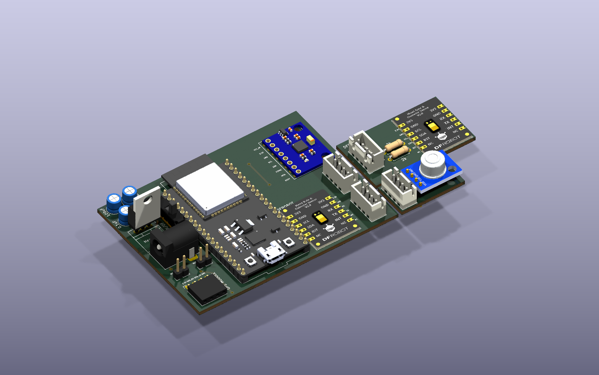
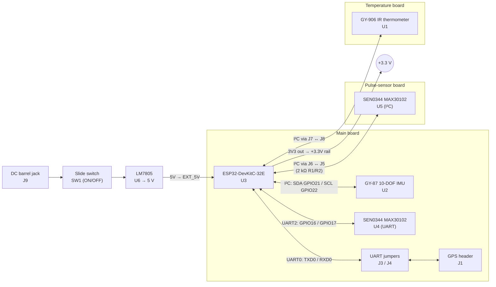
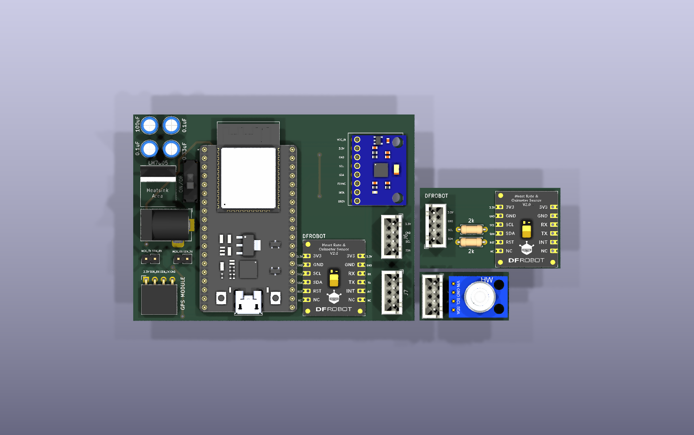
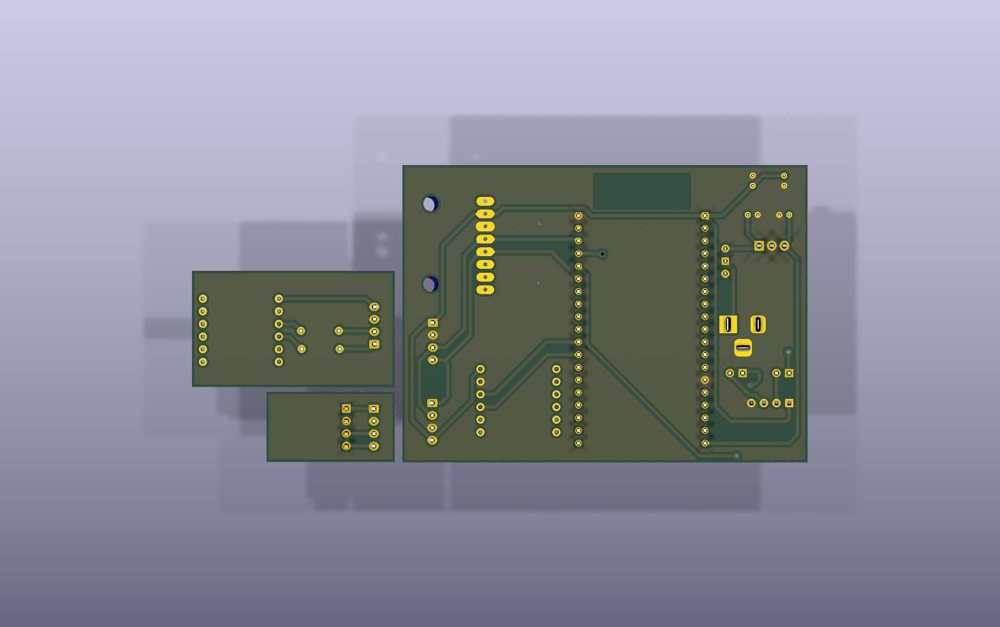
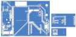
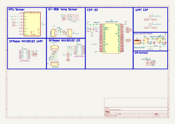

# Cow Health-Monitoring Collar: ESP32 Sensor PCB

**An ESP32 carrier board and two small sensor boards for a wearable that monitors a cow's vital signs. It brings together body temperature, heart rate / SpO₂, motion and GPS on one powered PCB set, designed in KiCad 9.**



---

## Overview

This is the hardware for a livestock health monitor. A carrier board holds an **ESP32-DevKitC-32E** and connects it to:

- a **non-contact IR thermometer** (GY-906 module, MLX90614-class) for body/skin temperature
- **pulse-oximeter / heart-rate modules** (DFRobot **SEN0344**, MAX30102-based)
- a **10-DOF motion module** (GY-87: accelerometer/gyro/magnetometer/barometer) for activity and posture
- a **GPS module** header for location tracking

The design is split into **three boards in one KiCad file**: the main carrier board and two small remote sensor boards. These connect to the main board over 4-pin JST-XH I²C cables, so the temperature and pulse sensors can sit against the animal's skin away from the electronics. *(The cable pairing is inferred from the matching connector pin-outs. See [Connectors](#connectors-and-inter-board-wiring).)*

> Scope: this repository contains **hardware only**: schematic, PCB layout, Gerbers and 3D models. There is no firmware in this folder.

## Key features

- **ESP32-DevKitC-32E** plugs straight in, giving Wi-Fi + BLE and USB programming with no RF or USB-UART design needed on the carrier
- **Shared I²C bus** (GPIO21/22) for the IMU, IR thermometer and remote pulse sensor
- **Second pulse-sensor footprint on UART2** (GPIO16/17), so the DFRobot SEN0344 can run in its UART mode
- **GPS header on UART0** with two 2-pin jumper headers ("UART CAP"), so the GPS can be disconnected from the ESP32's USB-programming UART *(purpose inferred)*
- **Barrel-jack input → slide ON/OFF switch → LM7805 regulator**, with a marked heatsink area on the silkscreen
- **Copper keep-out under the ESP32 antenna** and a **GND pour on the bottom layer** of all three boards
- Only **through-hole parts and plug-in modules**, so it is easy to hand-solder and prototype
- **Two fabrication outputs**: a full **2-layer** Gerber set and a **1-layer** (bottom copper only) set for single-sided or home etching

## Block diagram



## Bill of materials

Generated from the schematic (`cow_pcb.kicad_sch`).

| Ref | Qty | Value / Part | Footprint | Function |
|---|---|---|---|---|
| U3 | 1 | ESP32-DEVKITC-32E | `ESP32-DEVKITC-32E:MODULE_ESP32-DEVKITC-32E` | Main MCU (Wi-Fi/BLE dev board) |
| U2 | 1 | GY-87 | `GY-87:GY-87` | 10-DOF IMU module (I²C) |
| U1 | 1 | GY-906 | `GY-609:Untitled` | IR thermometer module (I²C) |
| U4, U5 | 2 | DFRobot SEN0344 | `SEN0344:SEN0344` | MAX30102 heart-rate / SpO₂ (U4 on UART, U5 on I²C) |
| U6 | 1 | LM7805_TO220 | `TO-220-3_Vertical` | 5 V linear regulator |
| C3 | 1 | 0.33 µF | `C_Radial_D5.0mm` | Regulator input capacitor |
| C4 | 1 | 0.1 µF | `C_Radial_D5.0mm` | Regulator output capacitor (5 V) |
| C1 | 1 | 0.1 µF | `C_Radial_D5.0mm` | 3.3 V decoupling |
| C2 | 1 | 100 µF | `C_Radial_D5.0mm` | 3.3 V bulk capacitor |
| R1, R2 | 2 | 2 kΩ | `R_Axial_DIN0207_L6.3mm` | In series with SDA/SCL on the remote SEN0344 (U5) |
| J9 | 1 | Barrel_Jack_Switch | `BarrelJack_Horizontal` | DC power input |
| SW1 | 1 | Slide switch (Würth 450301014042 symbol) | `SW_Slide-03_Wuerth-WS-SLTV_10x2.5x6.4_P2.54mm` | Power ON/OFF |
| J1 | 1 | Conn_01x04 | `PinSocket_1x04_P2.54mm_Horizontal` | GPS module header (3V3, RX, TX, GND) |
| J3, J4 | 2 | Conn_01x02 | `PinHeader_1x02_P2.54mm_Vertical` | UART0 ↔ GPS jumpers |
| J5–J8 | 4 | 4-pin JST | `JST_XH_B4B-XH-A_1x04_P2.50mm_Vertical` | I²C + power links between the boards |

> The connector symbol value says "JST_1mm_4", but the footprint actually assigned is **JST-XH 2.50 mm**. The footprint is what gets built.

## ESP32 pin mapping

DevKitC-32E header pins as named in the schematic symbol (`J2_x` / `J3_x` = header/pin).

| ESP32 pin | Header pin | Net | Connected to |
|---|---|---|---|
| GPIO21 | J3_6 | `SDA` | U2 GY-87, U1 GY-906 (via J7/J8), U5 SEN0344 (via J6/J5 + R1) |
| GPIO22 | J3_3 | `SCL` | U2 GY-87, U1 GY-906 (via J7/J8), U5 SEN0344 (via J6/J5 + R2) |
| GPIO16 (UART2 RX) | J3_12 | `DF_TX` | U4 SEN0344 **TX** |
| GPIO17 (UART2 TX) | J3_11 | `DF_RX` | U4 SEN0344 **RX** |
| TXD0 (GPIO1) | J3_4 | `MCU_TX` | J4 pin 1 → (jumper) → `SEN_RX` → J1 pin 2 (GPS RX) |
| RXD0 (GPIO3) | J3_5 | `MCU_RX` | J3 pin 1 → (jumper) → `SEN_TX` → J1 pin 3 (GPS TX) |
| EXT_5V | J2_19 | `5V` | LM7805 output |
| 3V3 | J2_1 | `+3.3V` | Supply rail for every sensor and connector |
| GND | J2_14, J3_1 | `GND` | Common ground |

All other GPIOs are unconnected, which leaves room for later expansion. Interrupt and reset pins (MAX30102 `INT`/`RST`, GY-87 `INTA`/`DRDY`/`FSYNC`) are also left unconnected. A hand-written DevKit header map used during layout is in [`lib/esp32 pinout.txt`](lib/esp32%20pinout.txt).

### Connectors and inter-board wiring

| Connector | Board | Pin 1 → 4 |
|---|---|---|
| J6 | Main | 3V3, GND, SCL, SDA |
| J5 | Pulse-sensor board | SDA, SCL, GND, 3V3 |
| J7 | Main | SDA, SCL, GND, 3V3 |
| J8 | Temperature board | 3V3, GND, SCL, SDA |
| J1 | Main ("GPS MODULE") | 3V3, SEN_RX, SEN_TX, GND |

*Inferred:* J6 ↔ J5 and J7 ↔ J8 are cable pairs. Each pair has mirrored pin order, which suits a straight 4-wire JST cable between two boards that face each other.

## Power design

```
DC jack (J9) ──► SW1 ON/OFF ──► LM7805 (U6) ──► 5 V ──► DevKitC EXT_5V
                    C3 0.33 µF ┘          └ C4 0.1 µF
                                   DevKitC on-board 3.3 V LDO ──► +3.3 V rail ──► all sensors
                                                                 (C1 0.1 µF, C2 100 µF)
```

- The input voltage is not set in the design files. A 7805 normally needs about 7 V or more at the input for a stable 5 V output (general device rule, not stated in the project).
- The 3.3 V rail comes from the DevKitC's own regulator through its `3V3` pin. The carrier board adds bulk and decoupling capacitance only.
- The silkscreen marks a **"Heatsink Area"** next to the TO-220 regulator.
- The DevKitC can also be powered from its own USB port while you program it.

## PCB specifications

| Parameter | Value |
|---|---|
| EDA tool | KiCad 9.0 (Gerbers from Pcbnew 9.0.2) |
| Overall panel extent | 123.6 × 59.8 mm (from the Gerber job file) |
| Board outlines | 3 separate outlines: **main** 81.4 × 59.8 mm · **pulse-sensor board** 40.7 × 23.3 mm · **temperature board** 25.8 × 14.1 mm |
| Stack-up | 2 copper layers, FR4, 1.6 mm, 35 µm copper, no finish specified |
| Track width | 0.6 mm (all 119 segments) |
| Clearance | 0.5 mm |
| Vias | 7 vias, 1.4 mm pad / 0.6 mm drill |
| Copper pours | GND on B.Cu (one zone per board) |
| Keep-outs | Copper/track/via keep-out under the ESP32 antenna |
| Drill sizes | PTH 0.6 – 1.1 mm, NPTH 3.0 mm |
| Components | All on the top side, through-hole or plug-in modules |

### Fabrication variants

Both variants come from the same `.kicad_pcb` file and were exported on 2026-03-19.

| | `two_layer/` | `one_layer/` |
|---|---|---|
| Copper Gerbers | `F_Cu` + `B_Cu` | `B_Cu` only |
| Routing | 107 bottom + 12 top segments, 7 vias | Same bottom copper. The 12 top segments are absent |
| Other layers | Masks, paste, silk, Edge.Cuts, PTH/NPTH drill | Identical |
| Archive | `two_layer.zip` | `one_layer.zip` |
| Use case | Standard fab house order | Single-sided / home etching / low-cost prototype |

The top-copper traces carry only `MCU_TX`, `MCU_RX` and a short `GND` link. *Inferred:* when you build the single-layer version, these few links are made with wire jumpers through the via holes. The 1-layer job file still lists `LayerNumber: 2`, because it was exported from the 2-layer stack-up with only the F.Cu plot omitted.

## Gallery

| 3D top | 3D bottom |
|---|---|
|  |  |

**PCB layout**



**Schematic** ([PDF](docs/schematic.pdf))



## Repository structure

```
Cow-Health-Monitor/
├── README.md
├── docs/
│   ├── schematic.pdf
│   └── images/                  # 3D renders, layout & schematic SVGs
├── cow_pcb/
│   ├── cow_pcb.kicad_pro        # KiCad 9 project
│   ├── cow_pcb.kicad_sch        # Schematic
│   ├── cow_pcb.kicad_pcb        # PCB layout (3 board outlines)
│   ├── two_layer/  (+ .zip)     # 2-layer Gerbers + drill + job file
│   └── one_layer/  (+ .zip)     # 1-layer (B.Cu only) Gerbers + drill + job file
└── lib/
    ├── esp32 pinout.txt                        # DevKitC header map (layout notes)
    ├── IRThermoSensor/                         # GY-906 / HW-691 3D model (SolidWorks, STEP, Parasolid)
    ├── SEN0344_fermion-max30102-…_V2.0/        # DFRobot SEN0344 KiCad symbol/footprint, Altium lib, STEP
    ├── slide-switch-slw-116641-3a-ra-s-d-…/    # Slide switch STEP + preview images
    └── kicad-symbols/                          # Small legacy .lib symbols (GY-906, SSD1306, TP5591)
```

## How to open and manufacture

1. Install **KiCad 9.x** and open `cow_pcb/cow_pcb.kicad_pro`.
   - The schematic and PCB embed their symbols and footprints, so both open without extra libraries.
   - Some 3D models are linked by **absolute paths** (`D:/…`). Two of them, the ESP32-DevKitC and GY-87/GY-521 STEP files, are not in this repo. The 3D viewer will show those parts without bodies until you re-point the paths, for example to `${KIPRJMOD}/../lib/...`.
2. **Ordering boards:** upload `cow_pcb/two_layer.zip` (or `one_layer.zip`) to any PCB fab. The file has three separate outlines, so check whether your fab treats it as a multi-design panel. You can also separate the boards before ordering.
3. **Assembly:** all parts are through-hole or plug-in modules. Solder the regulator, capacitors, resistors, switch, jack and headers, then plug in the DevKitC and sensor modules.
4. Connect the remote sensor boards with 4-pin JST-XH cables (J6↔J5, J7↔J8). Fit the J3/J4 jumpers to link the GPS to UART0.

## Status and next steps

- [x] Schematic captured
- [x] PCB layout (main board + 2 sensor boards) routed
- [x] Gerbers exported in 1-layer and 2-layer variants
- [ ] Firmware (sensor drivers, data upload over Wi-Fi/BLE): not part of this repo
- [ ] Bench bring-up and validation
- Possible improvements: make the 3D-model paths project-relative, add I²C pull-ups on the carrier, connect the sensor `INT` lines to free GPIOs, add a power-input voltage rating and reverse-polarity protection, and consider a buck converter in place of the 7805 for battery operation.

---

**Author:** [@zeyad-hisham-cyper](https://github.com/zeyad-hisham-cyper) — Embedded Systems & PCB Design · Part of the [Freelance Projects](../README.md) portfolio
