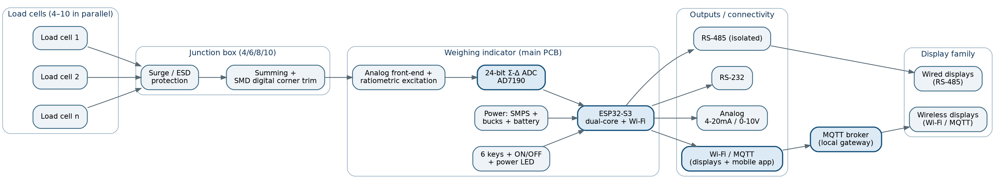
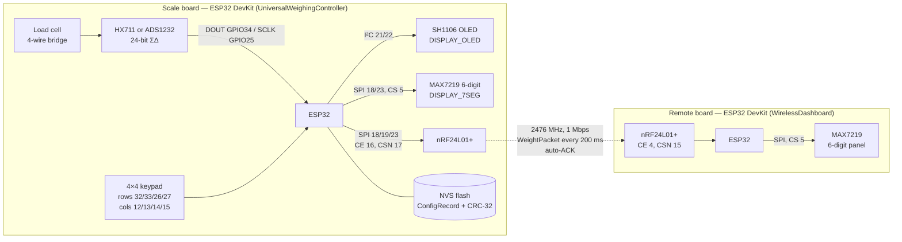
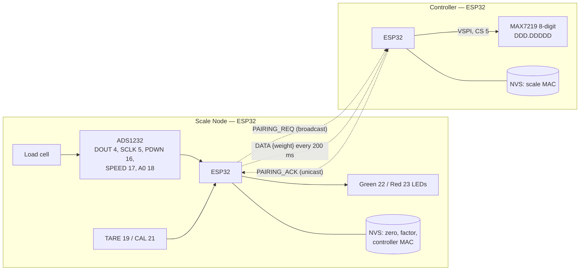
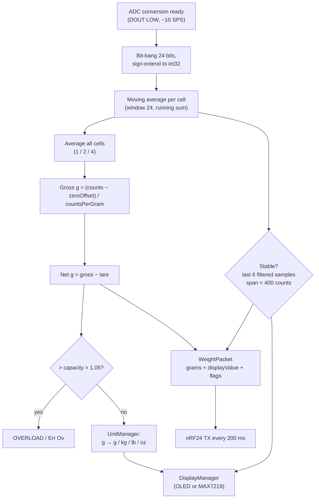
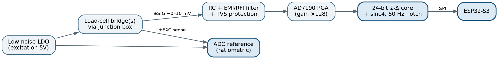
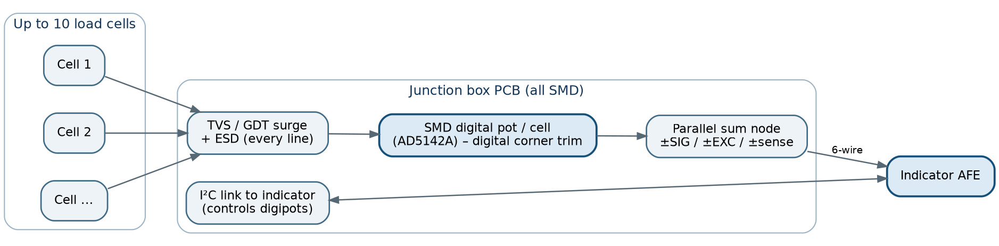
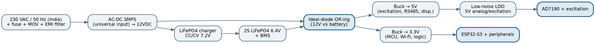
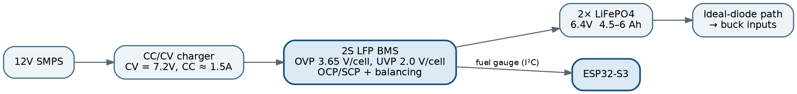
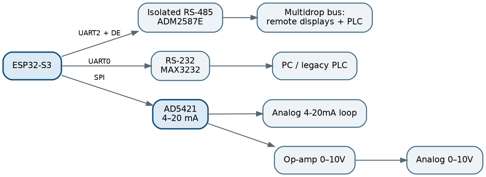
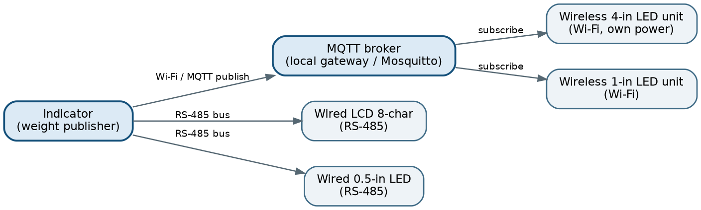

# Universal Digital Weighing Scale — ESP32 Load-Cell Indicator with Wireless Remote Display

> Load-cell weighing firmware and hardware for the ESP32, built up in stages:
> component research for a ±0.01 % industrial indicator, a prototype that
> sends weight over ESP-NOW, and a modular **"one firmware, many weighing
> systems"** controller. It supports two ADCs (ADS1232 / HX711), two displays
> (OLED / MAX7219) and an nRF24L01+ link to a remote panel.

<p align="center">
  
  <br><em>Bench test rig: single-point load cell on a 3D-printed frame (design by indrekluuk, Thingiverse #4602226)</em>
</p>

<p align="center">
  
  <br><em>Target product architecture from the Phase 1 research document</em>
</p>

---

## Table of contents

- [Overview](#overview)
- [Features](#features)
- [Project evolution](#project-evolution)
- [System architecture](#system-architecture)
- [Hardware](#hardware)
- [Firmware architecture](#firmware-architecture)
- [Weighing pipeline](#weighing-pipeline)
- [Wireless protocols](#wireless-protocols)
- [HMI — Nextion display](#hmi--nextion-display)
- [Mechanical — 3D-printed load-cell frame](#mechanical--3d-printed-load-cell-frame)
- [Build & flash](#build--flash)
- [Gallery](#gallery)
- [Repository structure](#repository-structure)
- [Status & roadmap](#status--roadmap)

---

## Overview

The project is a digital weighing indicator: strain-gauge load cell → 24-bit
ΣΔ ADC → ESP32 → local display and keypad. The weight can also be sent to a
remote display board over a wireless link. It was built in three stages:

1. **Phase 1 research** (`Phase1 Digital Scale Research.docx`). This is an
   engineering study for an industrial indicator that targets ±0.01 % of full
   scale (10 000 divisions). It covers the error budget, ADC and MCU selection
   (AD7190 + ESP32-S3), junction-box design for 4–10 cells, a mains +
   LiFePO4 power system, RS-485/RS-232/4–20 mA outputs, and a Wi-Fi/MQTT
   display network.
2. **v2 prototype** (`v2/`). An ESP32 + ADS1232 *Scale Node* with stability
   detection, two-point calibration in NVS, and automatic **ESP-NOW** pairing
   to an ESP32 *Controller* that drives an 8-digit MAX7219 display.
3. **MVP: Universal Weighing Controller** (`ScaleMVP/`). A modular firmware
   configured at compile time (driver / module / app layers). It supports
   ADS1232 or HX711, an SH1106 OLED or a MAX7219 6-digit display, and a
   4×4 keypad UI with an on-device calibration wizard. CRC-protected settings
   are stored in flash. A register-level **nRF24L01+** driver sends the weight
   to a separate *Wireless Dashboard* firmware.

The design rule behind the MVP: replacing a load cell, changing the display or
selecting a different ADC needs only a config change and a recalibration. The
application code stays the same.

## Features

**Measurement**
- 24-bit ΣΔ ADC: **ADS1232** (5-wire: DOUT/SCLK/PDWN/SPEED/A0) or **HX711** (2-wire). Both drivers are bit-banged with no external library, and one `#define` selects between them.
- Non-blocking acquisition: the main loop polls data-ready, so the UI keeps responding while the ADC runs at 10 SPS.
- Moving-average filter per load cell (circular buffer, running sum; `FILTER_WINDOW_SIZE` = 24).
- Stability detection on raw **counts**, which works before the scale has been calibrated.
- Multi-cell support built into the code: 1, 2 or 4 cells, one ADC each, averaged so the calibration factor does not depend on the cell count. Only the 1-cell pin set is filled in.
- Overload detection (`SCALE_CAPACITY_G × OVERLOAD_MARGIN`), ADC-timeout fault and radio fault detection.

**Calibration & storage**
- Guided 3-step calibration (zero → load → type the reference mass on the keypad). Each capture averages 16 samples.
- Rejects a calibration if the reference mass is out of range or the span is under `CAL_MIN_SPAN_COUNTS`.
- `ConfigRecord` holds a magic number, a layout version and a CRC-32. Flash is written only when the content changes.
- Tare / clear-tare. Unit cycle g → kg → lb → oz (display only; internally everything stays in grams).

**Display & UI**
- SH1106 128×64 OLED (bench build) or MAX7219 6-digit 7-segment panel (industrial build). Both use one `DisplayManager` interface.
- The MAX7219 driver uses no-decode mode with its own segment font (`CAL`, `tArE`, `Err rA` …). It also refreshes its control registers once a second so the panel recovers from SPI glitches.
- 4×4 membrane keypad with debounce and auto-repeat. The scan direction was chosen around the ESP32 strapping pin GPIO12.

**Wireless**
- MVP: register-level nRF24L01+ driver (no RF24 library), 16-byte versioned `WeightPacket`, auto-ACK, three-state link status (`NoRadio` / `Down` / `Up`), and the radio is re-detected automatically after a brown-out.
- v2: ESP-NOW broadcast pairing, peer MAC kept in NVS, unicast weight packets every 200 ms.

## Project evolution

> The order below follows the file timestamps (inferred). The folder named
> `v2/` has older timestamps (16 Jul 2026) than the `ScaleMVP/` controller
> (27 Jul – 5 Aug 2026).

| Stage | Folder | MCU | ADC | Display / UI | Link | Highlights |
|---|---|---|---|---|---|---|
| **Phase 1 – Research** (Jun–Jul 2026) | `Phase1 Digital Scale Research.docx` | ESP32-S3-WROOM-1 (proposed) | AD7190 (proposed); ADS1232/ADS1235 as second source; HX711 rejected for 10 000-count | HT1622 LCD, bicolor 7-seg remote displays | Wi-Fi + MQTT, RS-485, RS-232, 4–20 mA | Error budget, OIML R60 √N rule, ratiometric front-end, 2S LiFePO4 power path, junction box without trimpots |
| **Bring-up tests** | `test/`, `ScaleMVP/test.ino`, `ScaleMVP/hardware_test/`, `ScaleMVP/oled_test/` | ESP32 DevKit | ADS1232 | MAX7219 + 4×4 keypad, SH1106 / SSD1306 OLED | — | Pin validation; load-cell test bench with moving average + EMA filter, tare/cal/unit buttons |
| **HMI mock-ups** | `nxt/` | — | — | Nextion HMI pages | UART | "Universal Scaler" price-computing screen; service/config tool screen |
| **v2 – ESP-NOW prototype** | `v2/ScaleNode`, `v2/Controller` | ESP32 ×2 | ADS1232 | 2 buttons + 2 LEDs; 8-digit MAX7219 on the controller | **ESP-NOW** | Stability detector, NVS calibration, auto-pairing handshake |
| **MVP – Universal Weighing Controller** | `ScaleMVP/UniversalWeighingController`, `ScaleMVP/WirelessDashboard` | ESP32 DevKit ×2 | HX711 (default) or ADS1232 | SH1106 OLED or MAX7219 6-digit, 4×4 keypad | **nRF24L01+** | Layered firmware, compile-time config, CRC-protected settings, calibration wizard, fault diagnostics |

## System architecture

### MVP — Universal Weighing Controller + Wireless Dashboard



### v2 — ESP-NOW Scale Node + Controller



### Target product (Phase 1 research)

The research proposes a weighing indicator board (ESP32-S3 + AD7190) as the
central unit. Peripherals (junction box, remote displays) connect over
RS-485 and Wi-Fi/MQTT. Large remote displays have their own power and
controllers (ESP32-C3) and only receive data. See the diagram at the top of
this page and the figures in the [Gallery](#gallery).

## Hardware

### MVP bill of materials (from `ScaleMVP/bom.docx` / `bom.pdf`)

| Board | Component | Interface | Notes |
|---|---|---|---|
| Controller | ESP32 DevKit | — | `ESP32 Dev Module` |
| Controller | HX711 load-cell amplifier/ADC | 2-wire | DT GPIO34 (input-only), SCK GPIO25; 5 V / 3.3 V depending on module |
| Controller | SH1106 128×64 OLED | I²C 0x3C | SDA 21, SCL 22 |
| Controller | 4×4 matrix keypad | GPIO matrix | GPIO12 and GPIO15 are strapping pins (see firmware notes) |
| Controller | nRF24L01+ | SPI | CE 16, CSN 17, **3.3 V only** |
| Controller *(option)* | ADS1232 instead of HX711 | GPIO | DOUT 34, SCLK 25, PDWN 26, SPEED 27, A0 14. Cannot be fitted together with the 4×4 keypad without a PCF8574 expander |
| Controller *(option)* | MAX7219 6-digit 7-segment instead of the OLED | SPI | DIN 23, CLK 18, CS 5, 5 V. Shares the SPI bus with the nRF24 |
| Dashboard | ESP32 DevKit | — | |
| Dashboard | MAX7219 6-digit 7-segment | SPI | DIN 23, CLK 18, CS 5, 5 V |
| Dashboard | nRF24L01+ | SPI | MOSI 23, MISO 19, SCK 18, CE 4, CSN 15, 3.3 V only, IRQ not connected |
| Both | Load cell | — | 20 kg 4-wire single-point cell on the 3D-printed frame (inferred from the Thingiverse frame; firmware default `SCALE_CAPACITY_G = 20000`) |

### Pinout — Universal Weighing Controller (`src/config/pins.h`)

| Function | Signal | GPIO |
|---|---|---|
| HX711 / ADS1232 | DOUT / DT | 34 |
| HX711 / ADS1232 | SCLK / SCK | 25 |
| ADS1232 only | PDWN, SPEED, A0 | 26, 27, 14 |
| SH1106 OLED | SDA, SCL | 21, 22 |
| Shared SPI | SCK, MOSI, MISO | 18, 23, 19 |
| MAX7219 | CS | 5 |
| nRF24L01+ | CE, CSN | 16, 17 |
| 4×4 keypad | Rows R0–R3 | 32, 33, 26, 27 |
| 4×4 keypad | Cols C0–C3 | 12, 13, 14, 15 |

### Hardware design notes (from the firmware documentation)

- **ADS1232 vs HX711**: the keypad uses GPIO 26/27/14, which are also the ADS1232 control pins. `config.h` stops the build with an `#error` if both are enabled. The shipped config therefore uses the HX711.
- **Strapping pin GPIO12**: keypad columns must be inputs and must have no external pull-ups. If GPIO12 is HIGH at reset, the ESP32 selects 1.8 V flash and does not boot.
- **MAX7219 at 5 V driven from 3.3 V logic** is outside the datasheet spec (V_IH = 3.5 V). The SPI clock is lowered to 1 MHz and the registers are refreshed periodically. A 74AHCT125 level shifter is the proper fix.
- **nRF24L01+ supply**: use 10 µF or more directly across the module's VCC/GND. Never connect it to 5 V.

### Phase 1 research — proposed industrial components (not built)

| Subsystem | Proposed part | Alternate |
|---|---|---|
| MCU | ESP32-S3-WROOM-1-N16R8 | ESP32-S3-WROOM-1-N8 |
| Weigh ADC | AD7190 (24-bit ΣΔ, ratiometric, 50 Hz notch) | AD7192, ADS1235 |
| Excitation/reference LDO | ADP7142 | TPS7A4700 |
| Junction-box corner trim | AD5142A SMD digipot | per-cell mux ADG1607 |
| RS-485 / RS-232 | ADM2587E (isolated) / MAX3232 | THVD1450 |
| Analog out | AD5421 4–20 mA + op-amp 0–10 V | DAC8551 + XTR111 |
| Power | Mean Well IRM-20/30-12, LMR33630 bucks, LM74700-Q1 ideal-diode OR | TPS54331 |
| Battery / charger / BMS | 2S LiFePO4 6.4 V 4.5–6 Ah, CN3768, BQ77216/BQ769x | 6 V SLA |
| Displays | HT1622 + negative LCD; MAX6954/MAX6958; MBI5024/TLC5940 for 4″ digits | green character OLED |

Main findings of the research: the C3 load cell limits accuracy, not the
ADC. The AD7190 gives about 54 000 noise-free counts against the 10 000
required, a ~5× margin. ±0.01 % is reachable only with deadweight
calibration plus multi-point linearization; weightless "auto-calibration"
reaches about 0.1–0.5 %.

## Firmware architecture

### Universal Weighing Controller — layered, configured at compile time

`app → modules → drivers → hardware`. Calls go only downward, never upward or
sideways. All customisation is in `src/config/` (`hardware.h`, `pins.h`,
`features.h`, `calibration.h`). `config.h` turns invalid combinations into
`#error`s.

| Layer | Module | Responsibility |
|---|---|---|
| Drivers | `ADS1232` | Bit-banged 24-bit read, speed / channel / power-down pins |
| | `HX711` | 2-wire read, gain via trailing pulses, read inside a critical section (prevents the >60 µs SCK-high power-down) |
| | `MatrixKeypad` | 4×4 scan, timestamp debounce, auto-repeat, key queue |
| | `OledDisplay` | SH1106 screens (Adafruit SH110X/GFX) |
| | `MAX7219` | No-decode 7-segment font, layouts, self-test, periodic register refresh |
| | `NRF24` | Register-level nRF24L01+ transceiver (no RF24 library) |
| | `SpiBus` | One-time shared-SPI bring-up, deselects every chip select first |
| | `EepromStore` | Byte-level persistence (ESP32 EEPROM-on-NVS) + CRC-32 |
| Modules | `WeightManager` | Polls each ADC → per-cell filter → averaged raw counts; fault timeout |
| | `FilterManager` | Moving average + peak-to-peak stability window |
| | `CalibrationManager` | Zero offset, counts/gram, tare, 3-step calibration state machine |
| | `UnitManager` | g / kg / lb / oz (exact conversion factors) |
| | `DisplayManager` | One interface (`showWeight`, `showCalibrationStep`, …) for OLED or MAX7219 |
| | `InputManager` | Key map: A = TARE, B = UNIT, C = ENTER/CAL, D = CANCEL, `*` = decimal point, `#` = backspace |
| | `StorageManager` | Versioned `ConfigRecord` (magic `SCL1`, CRC-32, writes skipped when unchanged) |
| | `WirelessManager` | Builds packets, rate-limits TX, tracks link state from ACKs, re-probes the radio |
| | `DiagnosticManager` | Warm-up, ADC fail, overload, radio fault |
| App | `setup.cpp` / `loop.cpp` | Power-on sequence; loop: input → acquire → housekeeping → keys → display → transmit |

The **Wireless Dashboard** uses the same layout (`SpiBus`, `MAX7219`, `NRF24`
drivers; `WirelessManager`, `DiagnosticManager`, `DisplayManager`,
`UnitFormat` modules). Its main loop is: receive → validate → classify → display.

### v2 — flat Arduino sketches

| Sketch | Classes |
|---|---|
| `ScaleNode` | `ADS1232`, `ScaleReader`, `StabilityDetector`, `WeightCalculator`, `CalibrationManager` (buttons, LEDs, NVS), `EspNowManager` |
| `Controller` | `Display` (MD_MAX72XX), `EspNowManager` |

## Weighing pipeline



**Calibration** (keypad **C**): (1) empty platform, average 16 samples → zero
offset; (2) place the reference mass; (3) type its mass in grams. Then
`countsPerGram = (loaded − zero) / mass`. The result is rejected if the span is
below `CAL_MIN_SPAN_COUNTS` (1000) or the mass is outside 1 g … capacity. The
result is saved with CRC, and the tare is cleared. An uncalibrated board
reads raw counts (factor 1.0), so the wrong value is obvious.

**v2 differences**: no moving average. Stability = 10 raw samples within
150 counts. Tare overwrites the zero offset and is allowed only when stable.
The reference weight is typed over Serial.

**Early test bench** (`ADS1232_LoadCell_Test.ino`): a 20-sample moving
average followed by an EMA (α = 0.2), with an SSD1306 OLED.

## Wireless protocols

### MVP — nRF24L01+ `WeightPacket` (16 bytes, `src/protocol/WeightPacket.h`)

| Offset | Field | Type | Meaning |
|---|---|---|---|
| 0 | `magic` | `uint8_t` | `0x5A` (rejects packets from other nRF24 systems) |
| 1 | `version` | `uint8_t` | `0x01`; the receiver rejects versions it does not know |
| 2 | `unit` | `uint8_t` | 0 = g, 1 = kg, 2 = lb, 3 = oz (static-asserted against `UnitManager`) |
| 3 | `flags` | `uint8_t` | bit0 STABLE, bit1 TARED, bit2 CALIBRATED, bit3 FAULT |
| 4 | `sequence` | `uint16_t` | Increments per TX; the dashboard counts gaps as missed packets |
| 6 | `reserved` | `uint16_t` | Alignment, sent as 0 |
| 8 | `grams` | `float` | Canonical net weight in grams |
| 12 | `displayValue` | `float` | Same reading converted to `unit` |

Radio settings (must match on both boards): channel 76 (2476 MHz), 1 Mbps,
0 dBm, 5-byte addresses `SCAL1` / `SCAL2`, 20-byte fixed payload, auto-ACK
with 5 retries. TX interval 200 ms; the link times out after 2 s. The
dashboard shows `Err no` rather than an old value. `WeightPacket.h`, `SpiBus.*`,
`MAX7219.*` and `NRF24.*` are byte-identical copies in both sketches.

### v2 — ESP-NOW `ScaleData` (8 bytes, `DataTypes.h`)

| Offset | Field | Type | Meaning |
|---|---|---|---|
| 0 | `packetType` | `uint8_t` | `0x01` PAIRING_REQ, `0x02` PAIRING_ACK, `0x03` DATA |
| 1 | `magic[3]` | `uint8_t[3]` | `'S','C','L'` |
| 4 | `weight` | `float` | Calibrated weight (0 in pairing packets) |

Pairing: the node broadcasts `PAIRING_REQ` every 2 s → the controller saves
the node's MAC and replies with `PAIRING_ACK` → the node saves the
controller's MAC and switches to unicast `DATA` every 200 ms. Both MACs are
kept in NVS, so pairing happens only once. A PMK is configured, but
per-peer encryption (LMK) is not enabled yet.

## HMI — Nextion display

`nxt/` holds Nextion Editor projects. These are UI mock-ups only; **no firmware
in this repo drives a Nextion yet**. The ADS1232 test bench's display layer is
written so it can be switched to `t0.txt=…` commands over `Serial2`.

| File | Content (from the strings embedded in the files) |
|---|---|
| `first.HMI` / `first.tft` | Start page: "Hello Welcome in Universal Scaler", with **Weight**, **Unit Price** and **Total** fields (a price-computing scale screen). `.tft` is the compiled firmware for the panel |
| `scale.HMI` | "SCALE SERVICE TOOL" / "HARDWARE CONFIGURATION" pages: ADC type, display type (OLED / 7 Segment / Nextion), number of load cells, scale capacity, zero calibration, span calibration + span weight, REBOOT, "FW 1.0.0". Uses 9600 baud |
| `*.zi` | Generated Nextion font files (main, title, sub, sub2) |

The service-tool screens match the compile-time options of the Universal
Weighing Controller. This suggests (inferred) a planned move to settings that
can be changed at runtime from a touch panel.

## Mechanical — 3D-printed load-cell frame

The bench rig uses **"Load cell frame" by [indrekluuk](https://www.thingiverse.com/thing:4602226)**
(Thingiverse thing **4602226**), a frame for a 20 kg four-wire
single-point load cell. It was originally designed for an Arduino + HX711.
The base and top-plate STLs are in `Load cell frame - 4602226/files/`.

> **License:** Creative Commons — Attribution — Non-Commercial (CC BY-NC), per
> `Load cell frame - 4602226/LICENSE.txt`. The design and images belong to
> their author. They are included here unmodified for reference and are not
> covered by this repository's own license.

The base was sliced for a Monoprice MP Select Mini (inferred from the `MPTI3` file prefix);
the printer-specific G-code is not committed, so slice the STL files for your own printer.

## Build & flash

| | Universal Weighing Controller | Wireless Dashboard | v2 ScaleNode | v2 Controller |
|---|---|---|---|---|
| Sketch | `ScaleMVP/UniversalWeighingController/UniversalWeighingController.ino` | `ScaleMVP/WirelessDashboard/WirelessDashboard.ino` | `v2/ScaleNode/ScaleNode.ino` | `v2/Controller/Controller.ino` |
| Board | ESP32 Dev Module | ESP32 Dev Module | ESP32 Dev Module | ESP32 Dev Module |
| Core | esp32 core 3.x (README reports a build verified on 3.2.1) | esp32 core | esp32 core **3.x** (`esp_now_recv_info_t`) | esp32 core **3.x** |
| Libraries | Adafruit GFX, Adafruit SH110X (OLED build only) | none | none | MD_MAX72XX |
| Configure | `src/config/hardware.h`, `pins.h`, `features.h` | `src/config/hardware.h` (radio settings must match the scale) | `Config.h` | `Config.h` |
| Serial | 115200 | 115200 | 115200 (Newline, used for calibration input) | 115200 |

Bench tests: `ScaleMVP/hardware_test/` (ADS1232 raw read), `…/ADS1232_LoadCell_Test/`
(Adafruit SSD1306 + GFX), `ScaleMVP/oled_test/` (SH1106 + 3 buttons),
`test/test.ino` (MAX7219 via MD_MAX72XX + 4×4 keypad via the `Keypad` library).

Command line (optional):

```bash
arduino-cli compile --fqbn esp32:esp32:esp32 ScaleMVP/UniversalWeighingController
arduino-cli upload  --fqbn esp32:esp32:esp32 -p COM5 ScaleMVP/UniversalWeighingController
```

Detailed bring-up, tuning and troubleshooting guides:
[UniversalWeighingController/README.md](ScaleMVP/UniversalWeighingController/README.md) ·
[WirelessDashboard/README.md](ScaleMVP/WirelessDashboard/README.md) ·
[v2/ScaleNode/README.md](v2/ScaleNode/README.md) ·
[v2/Controller/README.md](v2/Controller/README.md)

## Gallery

| | |
|---|---|
| <br>Load-cell frame (Thingiverse #4602226) | <br>Printed top plate |
| <br>Research: ratiometric analog front-end | <br>Research: junction box (4/6/8/10 cells) |
| <br>Research: mains + battery power topology | <br>Research: 2S LiFePO4 charge path |
| <br>Research: RS-485 / RS-232 / 4–20 mA | <br>Research: Wi-Fi/MQTT display network |

## Repository structure

```
Digital-Weighing-Scale/
├── README.md                          ← this file
├── Phase1 Digital Scale Research.docx Phase 1 engineering research & component selection
├── docs/images/                       figures extracted from the research document
├── ScaleMVP/
│   ├── system.md                      original system specification
│   ├── bom.docx / bom.pdf             MVP BOM & pinout (controller + dashboard)
│   ├── UniversalWeighingController/   main scale firmware (layered, configured at compile time)
│   │   ├── UniversalWeighingController.ino
│   │   └── src/{app,config,drivers,modules,protocol}/
│   ├── WirelessDashboard/             nRF24 → MAX7219 remote display firmware
│   │   └── src/{app,config,drivers,modules,protocol}/
│   ├── hardware_test/                 ADS1232 bring-up + full load-cell test bench
│   ├── oled_test/                     SH1106 OLED + button test
│   └── test.ino                       MAX7219 + keypad test (same as test/test.ino)
├── v2/
│   ├── ScaleNode/                     ESP32 + ADS1232 + ESP-NOW transmitter
│   └── Controller/                    ESP-NOW receiver + 8-digit MAX7219
├── nxt/                               Nextion HMI projects (.HMI, compiled .tft, .zi fonts)
├── test/test.ino                      MAX7219 + 4×4 keypad test
└── Load cell frame - 4602226/         third-party 3D-printable frame (CC BY-NC)
```

## Status & roadmap

**Done**
- Bench bring-up sketches for the ADS1232 + load cell, SH1106 OLED + buttons, and MAX7219 + keypad (the source of the MVP pin map).
- MVP controller + dashboard pair. The dashboard README records that digit-order and display-test faults were found on real hardware and fixed. The fixes are not yet re-verified on the bench.
- v2 ESP-NOW node/controller with pairing and NVS calibration.

**Open items (from the code and READMEs)**
- Pin sets for 2- and 4-cell platforms. Per-cell fault detection.
- An ADS1232 + keypad build needs a pin remap or a PCF8574 expander.
- ESP-NOW encryption (LMK); link-loss indication on the v2 controller.
- Nextion firmware integration (runtime configuration / service tool).

**Future features listed in `system.md`**: RS-232 / RS-485 / Modbus RTU,
Ethernet, Wi-Fi dashboard, Bluetooth, data logging / SD card, cloud,
relay outputs, 4–20 mA / 0–10 V analog output, web configuration, OTA updates,
password-protected calibration.

---

**Author:** [@zeyad-hisham-cyper](https://github.com/zeyad-hisham-cyper) — Embedded Systems & PCB Design · Part of the [Freelance Projects](../README.md) portfolio
