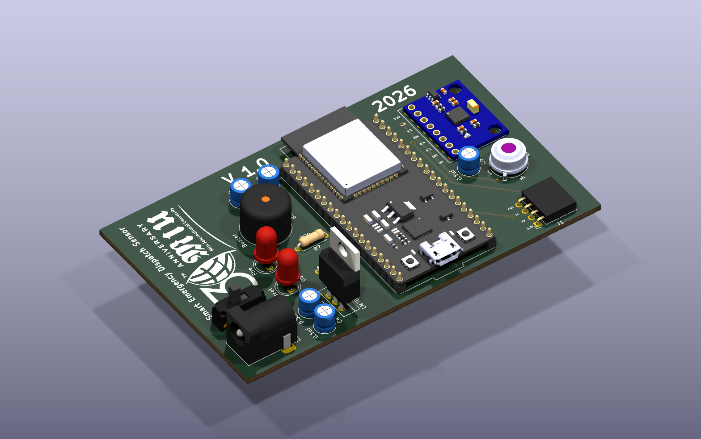
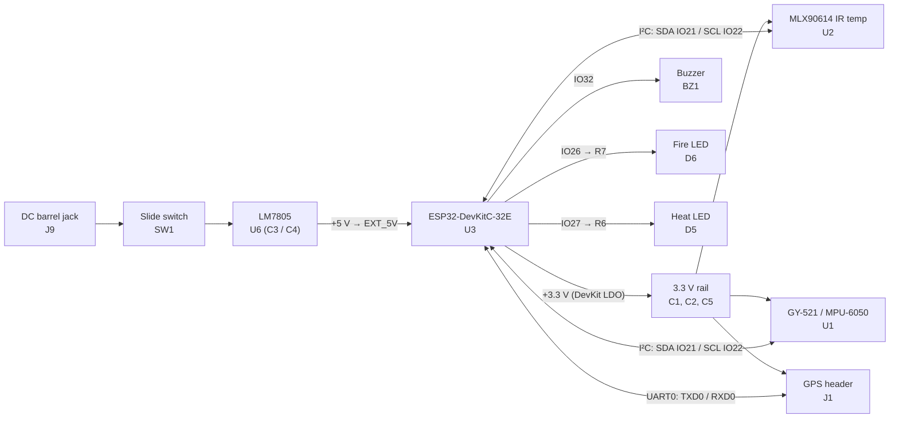
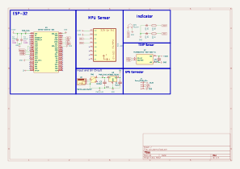
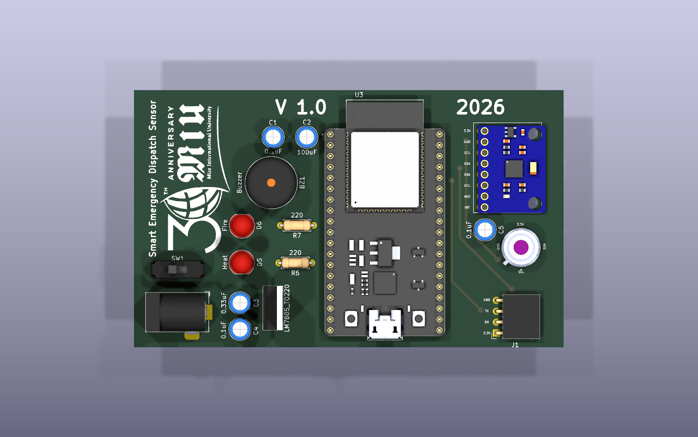
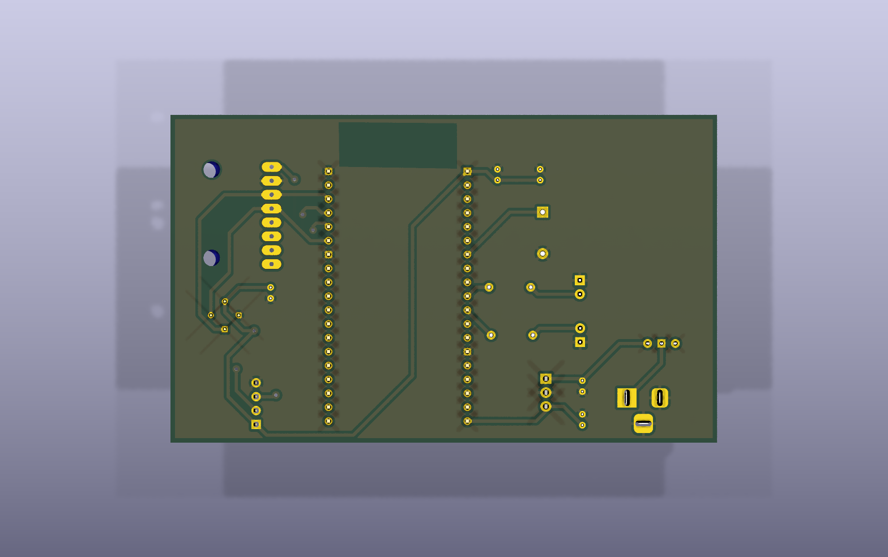
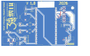

# Smart Emergency Dispatch Sensor (V1.0)

**An ESP32-based sensor board that pairs an IR thermometer with a 6-axis motion sensor and a GPS header, built to detect heat, fire or impact events and raise a local alarm.** Designed in KiCad 9 as a 2-layer, 100 × 60 mm through-hole PCB.



---

## Overview

The *Smart Emergency Dispatch Sensor* is a carrier PCB for an **ESP32-DevKitC-32E** module. It brings together:

- an **MLX90614** non-contact infrared temperature sensor, for heat and fire detection,
- a **GY-521 (MPU-6050)** accelerometer/gyroscope breakout, for motion, tilt or impact detection (inferred from the "MPU Sensor" block),
- a **4-pin UART header** marked *"GPS Connector"* in the schematic, for an external GPS module,
- a **buzzer** and two indicator LEDs, silkscreened **Fire** and **Heat**,
- a **DC barrel-jack input**, with a power slide switch and an LM7805 5 V regulator.

The project folder is named `car_alarm`, and the sensor mix of temperature, motion and GPS points to a **vehicle emergency or crash-and-fire alert unit** that can report its location over the ESP32's Wi-Fi/Bluetooth. That purpose is *inferred* from the hardware: the repository holds the hardware design only.

The board is silkscreened *"Smart Emergency Dispatch Sensor — V 1.0 — 2026"* and carries the Misr International University (MIU) 30th-anniversary logo.

## Key features

- **ESP32-DevKitC-32E** socketed as a module: Wi-Fi + BLE, and USB programming through the DevKit's own USB port
- **Shared I²C bus** (GPIO21 = SDA, GPIO22 = SCL) for the MLX90614 IR thermometer and the MPU-6050 IMU
- **UART header (J1)** on the ESP32's UART0 (TXD0/RXD0) with a 3.3 V supply, for a GPS module
- **Local alarm outputs**: a 12 mm buzzer and two 5 mm LEDs (Fire / Heat) with 220 Ω current limiting
- **Power input**: a horizontal DC barrel jack → slide on/off switch → LM7805 (TO-220) → 5 V into the DevKit; the DevKit's onboard LDO then supplies the 3.3 V rail for the sensors
- **Through-hole design** for easy hand assembly: every part is THT, and the ESP32 and GY-521 are plug-in modules
- **Solid GND pour** on the bottom layer, with a copper keep-out under the ESP32 antenna area
- **Production files included**: Gerber + Excellon drill + job file, exported from KiCad 9.0.2

## Block diagram



## Schematic



The design fits on one sheet, split into labelled blocks: *Input and 5V Circuit*, *ESP-32*, *TEMP Sensor*, *MPU Sensor*, *Indicator* and *GPS Connector*. A PDF copy is at [`docs/schematic.pdf`](docs/schematic.pdf).

## Bill of materials

| Ref | Value | Footprint | Qty | Purpose |
|---|---|---|---|---|
| U3 | ESP32-DevKitC-32E | `ESP32-DEVKITC-32E:MODULE_ESP32-DEVKITC-32E` | 1 | Main MCU module (Wi-Fi/BLE) |
| U2 | MLX90614ESF-BAA-000-TU | `TO254P942H425-4` (TO-39, 4-pin) | 1 | Non-contact IR temperature sensor (3 V version), I²C |
| U1 | GY-521 | `GY-521:GY-521` | 1 | MPU-6050 accelerometer + gyroscope breakout, I²C |
| U6 | LM7805_TO220 | `Package_TO_SOT_THT:TO-220-3_Vertical` | 1 | 5 V linear regulator |
| J9 | Barrel_Jack_Switch | `Connector_BarrelJack:BarrelJack_Horizontal` | 1 | DC power input |
| SW1 | Slide switch (Würth 450301014042 symbol) | `SW_Slide-03_Wuerth-WS-SLTV_10x2.5x6.4_P2.54mm` | 1 | Power on/off |
| J1 | Conn_01x04 | `PinSocket_1x04_P2.54mm_Horizontal` | 1 | GPS / UART header (3.3V, TX, RX, GND) |
| BZ1 | Buzzer | `Buzzer_Beeper:Buzzer_12x9.5RM7.6` | 1 | Audible alarm |
| D6 | LED (Fire) | `LED_THT:LED_D5.0mm` | 1 | Fire indicator |
| D5 | LED (Heat) | `LED_THT:LED_D5.0mm` | 1 | Heat indicator |
| R6, R7 | 220 Ω | `R_Axial_DIN0207_L6.3mm_D2.5mm_P7.62mm_Horizontal` | 2 | LED current limiting |
| C3 | 0.33 µF | `C_Radial_D5.0mm_H5.0mm_P2.00mm` | 1 | LM7805 input capacitor |
| C4 | 0.1 µF | `C_Radial_D5.0mm_H5.0mm_P2.00mm` | 1 | LM7805 output capacitor (5 V) |
| C2 | 100 µF | `C_Radial_D5.0mm_H5.0mm_P2.00mm` | 1 | 3.3 V bulk capacitor |
| C1, C5 | 0.1 µF | `C_Radial_D5.0mm_H5.0mm_P2.00mm` | 2 | 3.3 V decoupling (C5 is placed next to the MLX90614) |

**Total:** 17 placed components, all through-hole.

## ESP32 pin mapping

| ESP32 pin | Net | Connected to | Function |
|---|---|---|---|
| IO21 | `SDA` | U2 pin 2 (SDA/PWM), U1 SDA | I²C data |
| IO22 | `SCL` | U2 pin 1 (SCL/Vz), U1 SCL | I²C clock |
| TXD0 | `TX` | J1 pin 2 | UART0 TX → GPS |
| RXD0 | `RX` | J1 pin 3 | UART0 RX ← GPS |
| IO32 | `buzzer` | BZ1 (+) | Buzzer drive (direct from the GPIO) |
| IO26 | `LED1` | R7 → D6 (Fire) | Fire LED |
| IO27 | `LED2` | R6 → D5 (Heat) | Heat LED |
| EXT_5V | `5V` | LM7805 output | 5 V supply into the DevKit |
| 3V3 | `+3.3V` | U1, U2, J1, C1/C2/C5 | 3.3 V supply out of the DevKit |
| GND (×3) | `GND` | Ground pour | Ground |

All other ESP32 pins are left unconnected. That leaves GPIO4, 5, 13–19, 23, 25, 33–35 and others free for future expansion. The GY-521's `INT`, `AD0`, `XDA` and `XCL` pins are not connected, so the MPU-6050 sits at its default I²C address (0x68). The MLX90614 defaults to 0x5A, so the two sensors share the bus without conflict.

## Power design

```
DC jack (J9) ──► SW1 (on/off) ──► LM7805 (U6) ──► +5V ──► ESP32 DevKit EXT_5V
                                   C3 0.33µF in        │
                                   C4 0.1µF out        ▼
                                              DevKit onboard 3.3 V LDO
                                                       │
                                     +3.3V ──► MLX90614, GY-521, J1 (GPS)
                                               C1 0.1µF, C5 0.1µF, C2 100µF
```

- The input capacitors (0.33 µF in, 0.1 µF out) follow the standard LM7805 datasheet circuit.
- No separate 3.3 V regulator is fitted: the 3.3 V rail comes from the ESP32-DevKitC's own LDO through its `3V3` pin.
- The input voltage is not stated in the files. The LM7805 needs about 7 V or more at its input, so a 9–12 V adapter (or a 12 V vehicle supply, inferred) is the intended source.

## PCB specifications

| Parameter | Value |
|---|---|
| Board size | 100 × 60 mm (rectangular outline) |
| Layers | 2 (F.Cu / B.Cu) |
| Thickness | 1.6 mm |
| Track width | 0.6 mm on every track (79 segments, mostly routed on B.Cu) |
| Clearance (net class) | 0.5 mm |
| Minimum clearance (board rule) | 0.4 mm |
| Copper-to-edge clearance | 0.8 mm |
| Vias | 6, 1.4 mm pad / 0.6 mm drill |
| Drill sizes (PTH) | 0.6 – 1.1 mm |
| NPTH | 2 × 3.0 mm (GY-521 mounting holes) |
| Copper pour | GND zone on B.Cu |
| Keep-out | B.Cu copper/track/via keep-out under the ESP32 antenna area |
| Surface finish | Not specified (choose at the fab, e.g. HASL) |
| Components | 100 % through-hole, all on the top side |
| EDA | KiCad 9.0 |

The track and clearance rules are wide (0.6 mm tracks, 0.4–0.5 mm clearances), so the board fits the cheapest standard fab tiers and could also be home-etched or milled.

## Gallery

| Top | Bottom |
|---|---|
|  |  |

**PCB layout**



## Repository structure

```
Smart-Emergency-Dispatch-Sensor/
├── car_alarm.kicad_pro        # KiCad project
├── car_alarm.kicad_sch        # Schematic (single sheet)
├── car_alarm.kicad_pcb        # PCB layout
├── gerber/                    # Gerbers + Excellon drill + job file (KiCad 9.0.2)
├── gerber.zip                 # Same fabrication files, zipped for upload
├── lib/
│   └── MLX90614ESF-BAA-000-TU/  # Symbol, footprint and STEP model (SnapEDA)
└── docs/
    ├── schematic.pdf
    └── images/                # 3D renders, layout and schematic SVGs
```

## How to open and manufacture

1. **Open** `car_alarm.kicad_pro` in **KiCad 9** or later.
2. **Order PCBs**: upload `gerber.zip` as-is to **JLCPCB**, **PCBWay** or any similar fab. The job file says 2 layers, 1.6 mm thick, 100 × 60 mm. Standard options (FR-4, HASL, any solder-mask colour) are fine.
3. **Assemble**: every part is through-hole. Solder the passives, LEDs, buzzer and connectors first, then the regulator. Use female headers for the ESP32-DevKitC and the GY-521 so both can be removed.

> **Library note:** the MLX90614 library lives in `lib/`. The ESP32-DevKitC-32E and GY-521 symbols and footprints, and some 3D models, point to library paths outside this folder. The board files still open, and the Gerbers are complete, but a few 3D models may be missing in the 3D viewer.

## Status and next steps

- ✅ Schematic, PCB layout and fabrication outputs are complete (V1.0).
- ⏳ **No firmware is included.** It still needs: I²C drivers for the MLX90614 and MPU-6050, threshold or impact detection, GPS NMEA parsing, buzzer/LED alerts, and a Wi-Fi/BLE dispatch path.
- Possible hardware improvements for a V1.1:
  - add a transistor driver for the buzzer (it currently runs straight from GPIO32),
  - move the GPS from UART0 to UART2 so it doesn't clash with the USB programming/console port,
  - add board mounting holes,
  - add reverse-polarity protection on the DC input.

---

**Author:** [@zeyad-hisham-cyper](https://github.com/zeyad-hisham-cyper) — Embedded Systems & PCB Design · Part of the [Freelance Projects](../README.md) portfolio
