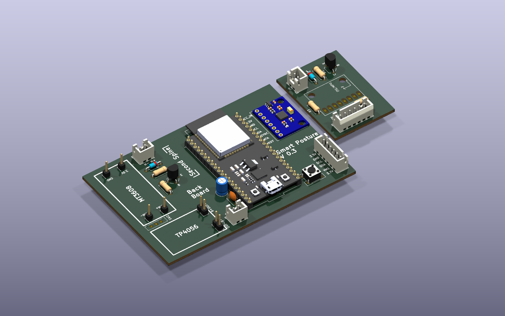
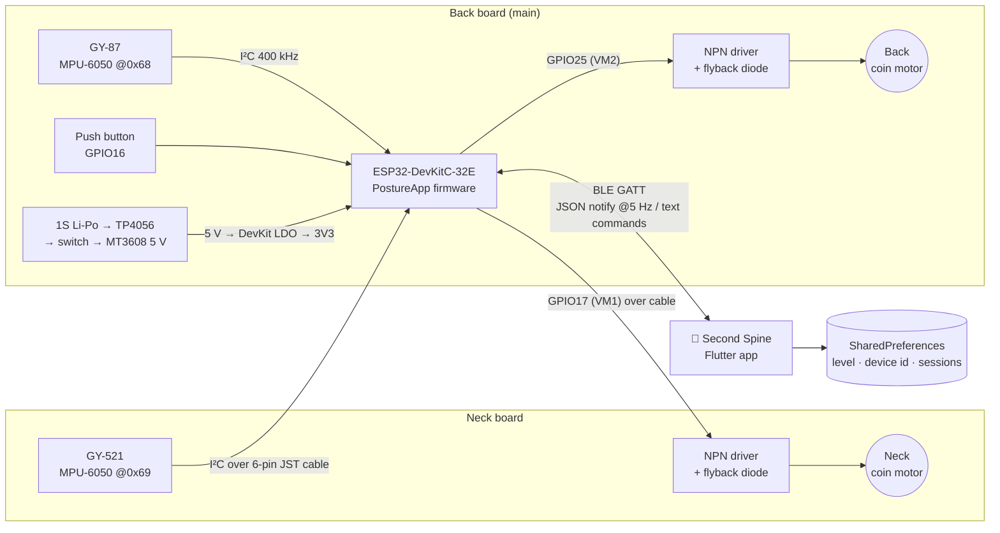
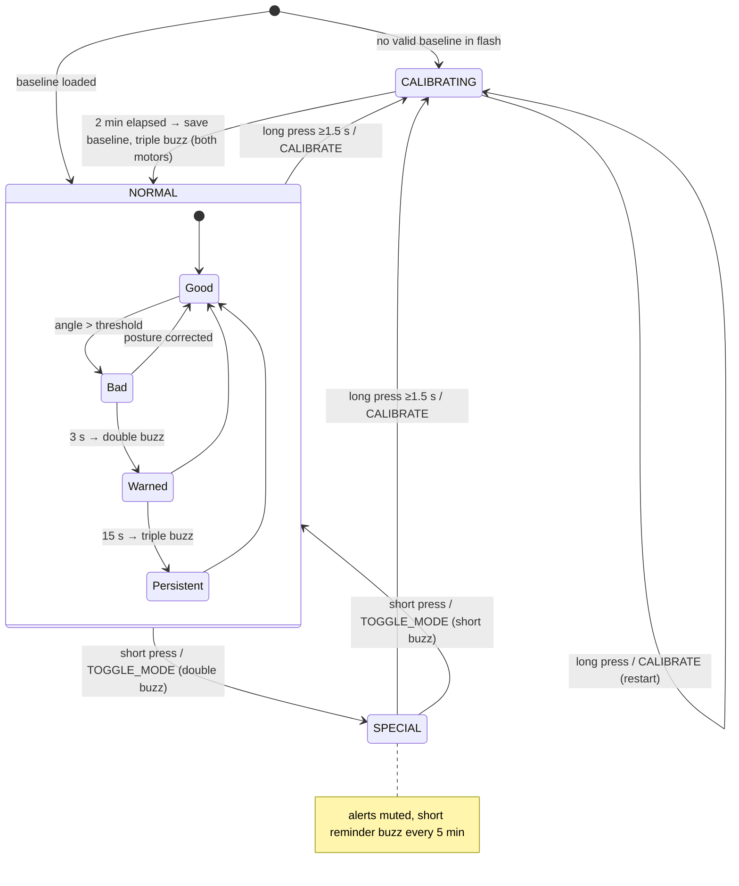
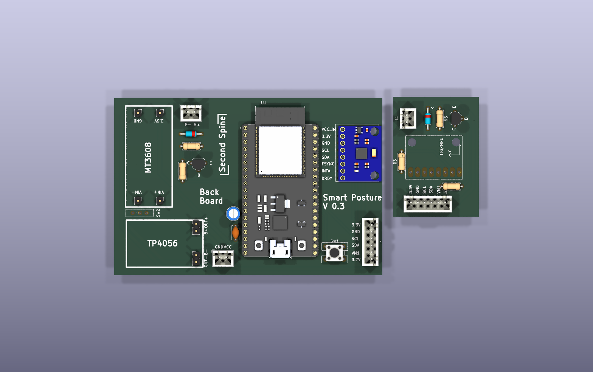
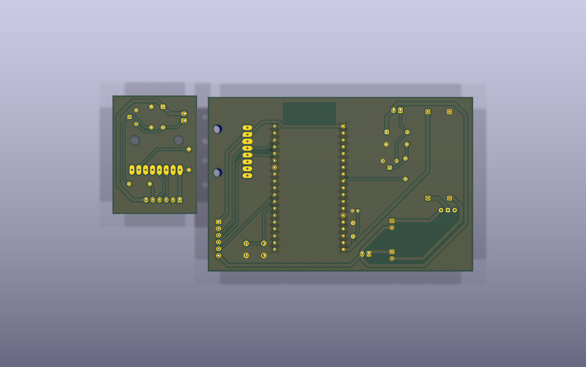
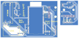
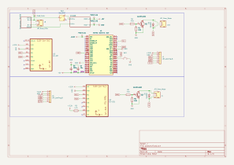
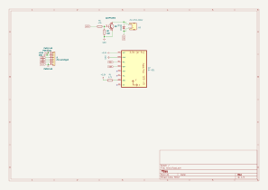

# Smart Posture Corrector — "Second Spine"

**A two-board wearable that watches your back and neck angle with two IMUs, buzzes you when you slouch, and streams live posture data to a Flutter companion app over Bluetooth Low Energy.**

ESP32 · 2× MPU-6050 · complementary filter · haptic feedback · BLE GATT · Flutter · KiCad 9 · 1S Li-Po with TP4056 charging and MT3608 boost



---

## Overview

The project began with a client specification (`Smart Posture Corrector.docx`) for a wearable aimed at **doctors and dentists**. These users spend long hours in strained working postures. The device needed to:

- monitor the **upper back (thoracic)** and **neck (cervical)** separately, and interpret the neck *relative to* the back ("sensor coherence")
- give a **gentle, location-specific vibration** when posture leaves the calibrated envelope
- **calibrate** to the user's normal working posture, then **tighten the threshold progressively** (adaptive correction, e.g. 30° → 25° → 20°)
- provide a **Special mode** for procedures that need an awkward posture. This mode mutes alerts but still gives a periodic "take a break" reminder.
- be controllable from a **button on the device** and from a **companion mobile app**

This repository contains the full implementation:

| Part | Folder | What it is |
|---|---|---|
| Firmware | [`main/posture controller/`](main/posture%20controller/) | PlatformIO / Arduino-ESP32 firmware (modular C++) |
| Mobile app | [`second_spine/`](second_spine/) | Flutter app "Second Spine" (BLE dashboard, controls, history) |
| Hardware | [`PCB/`](PCB/) | KiCad 9 project: Back board (main) + Neck board, plus Gerbers |
| Docs | [`docs/`](docs/) | Exported schematics (PDF/SVG), PCB layout and 3D renders |

> The device is a wellness and ergonomics aid for healthy users, not a medical device. The original specification says the same.

---

## Features

**Device / firmware**
- Two MPU-6050 IMUs on one I²C bus at 400 kHz: **back sensor at `0x68`**, **neck sensor at `0x69`**
- Pitch is estimated at **100 Hz** with a **complementary filter** (α = 0.96, gyro ±250 °/s)
- The neck angle is reported **relative to the back** (`neck − back`), so leaning the whole torso is not counted as a neck fault
- **Calibration** averages the user's posture over 2 minutes. The baseline and sensitivity level are stored in flash (EEPROM emulation) and survive power cycles.
- **6 sensitivity levels (0–5).** Each level tightens the threshold by 5°, with floors of 15° (back) and 10° (neck).
- **Two-stage, location-specific haptics:** a double buzz after 3 s of bad posture and a triple buzz after 15 s. Only the offending zone's motor (back or neck) vibrates.
- **Special mode:** posture alerts are muted and both motors give a short reminder buzz every 5 minutes
- **One-button UI:** a short press toggles Special mode and a long press (≥ 1.5 s) re-calibrates
- **BLE GATT server** (`PostureCorrector`): JSON telemetry at about 5 Hz plus a text command channel. Advertising restarts automatically after a disconnect.
- A serial debug console accepts single-key commands

**Companion app (Second Spine)**
- BLE scan and connect with Android 12+ runtime permissions
- Live dashboard: Good/Bad status, back and neck arc gauges against their thresholds, and per-zone hints
- Remote **Calibrate**, **Normal ↔ Special** toggle and **sensitivity slider**. The level is saved locally and re-sent on every connect.
- History screen with a posture-trend chart (fl_chart) and session cards (see the [status](#roadmap--status) note below)
- Dark "glass" UI theme using the Outfit font (Google Fonts), locked to portrait

**Hardware**
- Two custom PCBs connected by a 6-wire cable (3V3, GND, SCL, SDA, neck-motor drive, battery rail)
- 1S Li-Po → TP4056 charger module → slide power switch → MT3608 boost (5 V) → ESP32-DevKitC (on-board 3V3 LDO)
- Coin vibration motors on low-side NPN drivers with flyback diodes
- Through-hole (THT) design routed on the bottom copper layer only (see [PCB manufacturing](#pcb-manufacturing))

---

## System architecture



Data flow: **IMUs → complementary filter → back angle and neck-relative angle → threshold logic → vibration events**. In parallel, **angles, thresholds and mode → JSON → BLE notify → app UI**.

---

## Hardware

Two boards share one KiCad project (`PCB/posture.kicad_pro`). The v2 layout places both outlines on one panel. The silkscreen reads *"Back Board"*, *"Smart Posture V 0.3"* and *"Second Spine"*.

| Board | Outline (from `posture.kicad_pcb`) | Contents |
|---|---|---|
| **Back board (main)** | ≈ 98 × 65 mm | ESP32-DevKitC-32E, GY-87 IMU (back sensor), TP4056 and MT3608 module footprints, Li-Po JST, slide switch, push button, back motor driver and JST, 6-pin cable connector, bulk capacitors |
| **Neck board** | ≈ 31 × 44 mm | GY-521 IMU (neck sensor, AD0 pulled up → `0x69`), neck motor driver and JST, 6-pin cable connector |

There is also a standalone neck schematic at `PCB/neck/neck.kicad_sch` with the same circuit. No separate `neck.kicad_pcb` file exists in the repo. The neck layout lives in the combined `posture.kicad_pcb`, and the older standalone neck board survives only as Gerbers (`PCB/Board2/`).

### BOM highlights (from the schematic)

| Ref | Part | Role |
|---|---|---|
| U1 | ESP32-DevKitC-32E (module footprint) | MCU, BLE radio, USB programming |
| U3 | GY-87 10-DOF breakout (MPU-6050 + extras) | Back IMU, `0x68`. Only the MPU-6050 is used by the firmware. |
| U2 | GY-521 breakout (MPU-6050) | Neck IMU, `0x69` (R3 4.7 kΩ pulls AD0 to 3V3) |
| — | TP4056 module (J3/J11 headers) | 1S Li-Po charging (B+/B−, OUT+/OUT−) |
| — | MT3608 module (J5–J8 pins) | Boost converter, battery → +5 V for the DevKit |
| SW2 | SPDT slide switch | Main power (TP4056 OUT+ → MT3608 VIN+) |
| SW1 | Tactile push button | Mode / calibrate (GPIO16, internal pull-up) |
| Q1, Q2 | NPN BJT, TO-92 | Low-side vibration-motor switches |
| R2, R4 / R1, R5 | 470 Ω / 10 kΩ | Base resistor / base pull-down |
| D1, D3 | 1N4001 | Motor flyback diodes |
| J4, J10 | 2-pin JST | Coin vibration motors (neck / back) |
| J9 | 2-pin JST | 1S Li-Po battery |
| J1, J2 | 6-pin JST (locking) | Back ↔ Neck board cable |
| C3, C4 | 100 nF + 10 µF | +5 V decoupling |

Third-party symbols, footprints and 3D models (GY-521, GY-87, a C0720B001F coin-motor footprint) are in `PCB/lib/` and `PCB/GY-521.pretty/`. They were downloaded from SnapEDA.

### Pin map (ESP32-DevKitC-32E)

| Signal | GPIO | Net | Notes |
|---|---|---|---|
| I²C SDA | 21 | `SDA` | Shared by both IMUs and routed to the neck board |
| I²C SCL | 22 | `SCL` | 400 kHz |
| Back motor | 25 | `VM2` | Q1 → J10 (back board) |
| Neck motor | 17 | `VM1` | Sent over the cable → neck-board driver → neck motor |
| Button | 16 | `IO16` | Active-low, `INPUT_PULLUP`, 40 ms debounce |
| 5 V in | 5V pin | `+5V` | From MT3608 |
| 3V3 | 3V3 pin | `+3.3V` | DevKit LDO output → IMUs |

The firmware pins (`src/PostureApp.cpp`) match the v2 netlist.

**Inter-board cable (J1/J2, 6-pin):** `1 +3.3V · 2 GND · 3 SCL · 4 SDA · 5 VM1 · 6 3.7V`

### Power path

```
1S Li-Po (J9) ──► TP4056 module (charge + B−) ──OUT+──► SW2 ──► MT3608 boost ──► +5V ──► ESP32-DevKitC 5V pin
      │                                                                                     └─ on-board LDO ─► +3.3V ─► IMUs
      └──── "3.7V" rail (battery +) ──► coin motors (high side) ◄── NPN low-side switch ◄── GPIO
```

Inference from the netlist: the motors run directly from the battery rail and are switched on the low side. They draw nothing while the ESP32 is off, because the transistors are held off by the 10 kΩ base pull-downs. The design does not include battery-voltage sensing.

Schematics: [main board PDF](docs/main_board_schematic.pdf) · [neck board PDF](docs/neck_board_schematic.pdf)

---

## Firmware

PlatformIO project, `env:esp32dev` (Arduino framework, `espressif32`), 115200 baud monitor, 921600 baud upload.

### Module structure

```
posture controller/
├── src/main.cpp              → setup()/loop(), creates PostureApp
├── src/PostureApp.cpp        → app state machine, pins, button/serial/BLE wiring
├── include/PostureApp.h
├── lib/Sensors/              → raw MPU-6050 I²C reads + complementary filter
├── lib/PostureLogic/         → calibration, thresholds, bad-posture timing, EEPROM persistence
├── lib/Hardware/button.*     → debounced short/long press detector
├── lib/Hardware/vibrationCoin.* → non-blocking vibration patterns
├── lib/BLEDashboard/         → BLE GATT server (ESP32 BLE Arduino)
└── test/test_logic.cpp       → Unity tests for PostureLogic (see status)
```

Everything is **non-blocking** and driven by `millis()`. The main loop updates the button, sensors, motors and BLE every iteration.

### Posture algorithm

1. **Sensing (100 Hz).** For each MPU-6050, read 14 bytes from `0x3B`.
   - Accelerometer pitch: `atan2(−ax, √(ay² + az²))`
   - Gyro rate: `gy / 131` °/s
   - Fusion: `angle = 0.96·(angle + gyro·dt) + 0.04·accel_pitch`
2. **Neck coherence.** `neckRel = neckAngle − backAngle`
3. **Calibration (2 min).** The firmware averages `back` and `neckRel` to get the baseline, resets the level to 0 and saves the result to flash. The firmware comment marks the 2-minute duration as "for testing". The spec suggests 15–30 min or longer.
4. **Threshold.** `th = baseline − 5° × level`, clamped to **≥ 15° (back)** and **≥ 10° (neck)**.
5. **Detection.** Posture is bad when `|back| > backTh` **or** `|neckRel| > neckTh`.
   - Bad for 3 s → `FIRST_BAD` → double buzz
   - Bad for 15 s → `PERSISTENT_BAD` → triple buzz
   - Further alerts stop until posture recovers
   - Only the motor for the offending zone fires

**Flash layout (64-byte EEPROM emulation):** magic `0x504F5354` ("POST") @0, level @4, baseline back (float) @8, baseline neck (float) @12.

### State machine



### Vibration patterns

| Pattern | Timing | Used for |
|---|---|---|
| Short | 200 ms | Leaving Special mode, 5-min Special reminder |
| Double | 2 × (200 ms on / 150 ms off) | Entering Special mode, first bad-posture warning |
| Triple | 3 × (200 ms on / 150 ms off) | Calibration done, persistent bad posture |

### BLE protocol

Device name **`PostureCorrector`**. The service UUID is advertised with a scan response enabled.

| Item | UUID | Properties | Payload |
|---|---|---|---|
| Service | `12345678-1234-1234-1234-123456789abc` | — | — |
| Posture data | `12345678-1234-1234-1234-000000000001` | Read, Notify | JSON, about every 200 ms while connected |
| Command | `12345678-1234-1234-1234-000000000002` | Write | UTF-8 text command |
| Status | `12345678-1234-1234-1234-000000000003` | Read | `"CALIBRATING"` / `"NORMAL"` / `"SPECIAL"` |

**Notify payload:**

```json
{"back":12.50,"neck":-3.20,"backTh":15.0,"neckTh":10.0,"mode":1,"calibrating":false}
```

`mode`: `0` Calibrating, `1` Normal, `2` Special. `back` is in degrees and `neck` is the neck-relative angle.

**Commands:**

| Command | Effect |
|---|---|
| `CALIBRATE` | Start a 2-minute calibration |
| `TOGGLE_MODE` | Normal ↔ Special (ignored while calibrating) |
| `LEVEL:n` | Set sensitivity level `n` = 0–5 (values above 5 are clamped). Saved to flash. |

**Serial console (115200 baud):** `c` calibrate · `s` toggle Special · `n` force Normal · `0`–`5` set level. The device prints `[APP] Mode=… | Back=… | Neck=…` once per second.

---

## Mobile app — Second Spine

Flutter (Dart SDK `^3.10.4`), dark theme, portrait only. It has three tabs:

| Tab | Screen | What it does |
|---|---|---|
| Dashboard | `home_screen.dart` | Connection chip, Good/Bad status card (pulses when bad), calibrating spinner, back and neck `AngleGauge`s, Calibrate and Mode buttons, sensitivity slider (0–5) with live `±backTh / ±neckTh` |
| Connect | `connect_screen.dart` | Radar-style 15 s BLE scan, device list with RSSI, connect/disconnect. On connect it stores the device id and re-sends the saved `LEVEL:n`. |
| History | `history_screen.dart` | Posture-trend line chart (last 10 sessions) and session cards (duration, % good posture, Good ≥ 70 %) |

**Architecture:** `BleService` (a `ChangeNotifier` around `flutter_blue_plus` that exposes a `PostureData` stream) and `StorageService` (`shared_preferences` keys `sensitivity_level`, `last_device_id`, `session_history`, keeping at most 50 sessions).

**Packages** (`pubspec.yaml`): `flutter_blue_plus ^1.35.5`, `permission_handler ^12.0.1`, `shared_preferences ^2.3.4`, `fl_chart ^0.70.2`, `google_fonts ^6.2.1`, `cupertino_icons`. Dev: `flutter_lints ^6.0.0`.

See [`second_spine/README.md`](second_spine/README.md) for details.

---

## Build & flash the firmware

Requires [PlatformIO](https://platformio.org/) (CLI or the VS Code extension).

```bash
cd "main/posture controller"
pio run                         # build
pio run -t upload               # flash the ESP32-DevKitC over USB
pio device monitor -b 115200    # serial console (c / s / n / 0-5)
```

On first boot the device has no baseline, so it **starts calibrating immediately**. Sit or stand in your normal working posture for 2 minutes and wait for the triple buzz.

## Run the app

```bash
cd second_spine
flutter pub get
flutter run            # with an Android phone connected (BLE needs a real device)
flutter build apk      # release APK (currently signed with the debug key)
```

Android permissions (`BLUETOOTH_SCAN`, `BLUETOOTH_CONNECT`, and location on Android ≤ 11) are already declared in `AndroidManifest.xml`. iOS has not been configured yet; see the status section.

---

## PCB manufacturing

The design is KiCad 9 (`PCB/posture.kicad_pro`), 1.6 mm FR-4. All tracks (0.5 / 0.8 / 1.0 mm) are on **B.Cu** with a GND pour, and every part is through-hole. Each Gerber set exports bottom copper only (there is no `F_Cu.gbr`). That suits single-sided or home/CNC fabrication, and a fab house can also build it as a 2-layer board with an empty top layer.

| Folder | Date (job file) | Board size | Contents | Status |
|---|---|---|---|---|
| `PCB/Board1/` (+ `Board1.zip`) | 2026-01-13 | 103.8 × 61.9 mm | First back board. No on-board Li-Po JST, power switch or bulk caps; button net differs. | Superseded |
| `PCB/Board2/` (+ `Board2.zip`) | 2026-01-13 | 44.4 × 33.1 mm | First standalone neck board | Superseded |
| **`PCB/v2/`** (+ `v2/v2.zip`) | **2026-03-16** | **133.6 × 65.4 mm panel** | **Back board + neck board on one panel**. Adds Li-Po JST, SW2 power switch, 5 V decoupling and button on GPIO16, and matches the current firmware pin map. | **Current** |

Gerbers were generated with Pcbnew 9.0.2. For ordering, upload `PCB/v2/v2.zip`. It contains two separate outlines, so ask the fab to route or separate them, or order them as a panel.

---

## Gallery

| | |
|---|---|
|  |  |
| 3D render, top | 3D render, bottom (single-sided routing + GND pour) |

**PCB layout:** [`docs/images/main_board/pcb_layout.svg`](docs/images/main_board/pcb_layout.svg)



**Schematics**

| Sheet | File |
|---|---|
| Main board (root) | [`posture.svg`](docs/images/main_board/schematic/posture.svg) |
| TP4056 charger sheet | [`posture-TP4056.svg`](docs/images/main_board/schematic/posture-TP4056.svg) |
| MT3608 boost sheet | [`posture-MT3608.svg`](docs/images/main_board/schematic/posture-MT3608.svg) |
| Neck board | [`neck.svg`](docs/images/neck_board/schematic/neck.svg) |





---

## Repository structure

```
Smart-Posture-Corrector/
├── README.md                         ← you are here
├── Smart Posture Corrector.docx      ← original client specification
├── docs/
│   ├── main_board_schematic.pdf
│   ├── neck_board_schematic.pdf
│   └── images/
│       ├── main_board/   pcb_3d_iso/top/bottom.png, pcb_layout.svg, schematic/*.svg
│       └── neck_board/   schematic/neck.svg
├── main/                             ← firmware repo
│   ├── README.md
│   └── posture controller/           ← PlatformIO project
│       ├── platformio.ini
│       ├── include/  src/  lib/  test/
│       └── README.md                 ← BLE integration guide
├── second_spine/                     ← Flutter companion app
│   ├── pubspec.yaml
│   ├── lib/ (main.dart, models/, screens/, services/, theme/, widgets/)
│   ├── android/ ios/ web/ windows/ linux/ macos/
│   └── README.md
└── PCB/                              ← KiCad 9 project
    ├── posture.kicad_pro/.kicad_sch/.kicad_pcb   (main + neck panel)
    ├── TP4056.kicad_sch  MT3608.kicad_sch        (hierarchical sheets)
    ├── neck/neck.kicad_sch                       (standalone neck schematic)
    ├── GY-521.pretty/  lib/                      (third-party parts, SnapEDA)
    ├── Board1/  Board2/                          (v1 Gerbers)
    └── v2/                                       (current Gerbers)
```

---

## Roadmap / status

Status (from the files): the firmware, BLE protocol, app and v2 PCB are complete and consistent with each other. The items below are open or differ from the original spec.

- [ ] **Automatic weekly threshold tightening.** The level (0–5) is currently set manually from the app or serial console. The spec asks for automatic weekly progression.
- [ ] **Special-mode auto-timeout.** The spec suggests about 30 min. Today Special mode lasts until it is toggled off.
- [ ] **Production calibration time.** Calibration is 2 min (marked "for testing"). It also needs a stillness/validity check.
- [ ] **Session history.** `StorageService.addSession()` exists, but nothing records sessions yet, so the History tab stays empty.
- [ ] **Auto-reconnect.** `last_device_id` is saved but not yet used.
- [ ] **iOS.** `NSBluetoothAlwaysUsageDescription` must be added to `Info.plist` before BLE works on iOS.
- [ ] **Unit tests.** `test/test_logic.cpp` accesses private members, and its expected threshold ignores the 15° floor, so it needs updating before `pio test` passes.
- [ ] **Portability.** Some includes differ in case from the file names (`"Sensors.h"`, `"PostureLogic.h"`). This builds on Windows but will fail on Linux/macOS CI. The `Adafruit MPU6050` dependency and the `I2C_SDA/SCL` build flags are declared but unused.
- [ ] **Hardware ideas.** Battery-voltage sense, the GY-87 magnetometer/barometer (currently unused), and an enclosure / strap mount.

---

**Author:** [@zeyad-hisham-cyper](https://github.com/zeyad-hisham-cyper) — Embedded Systems & PCB Design · Part of the [Freelance Projects](../README.md) portfolio
