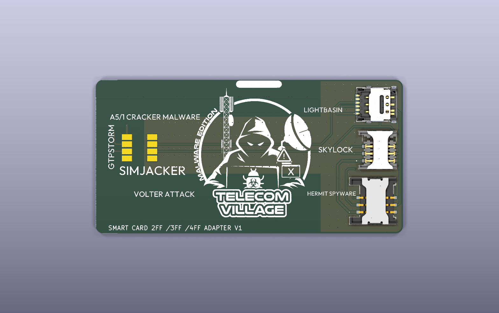
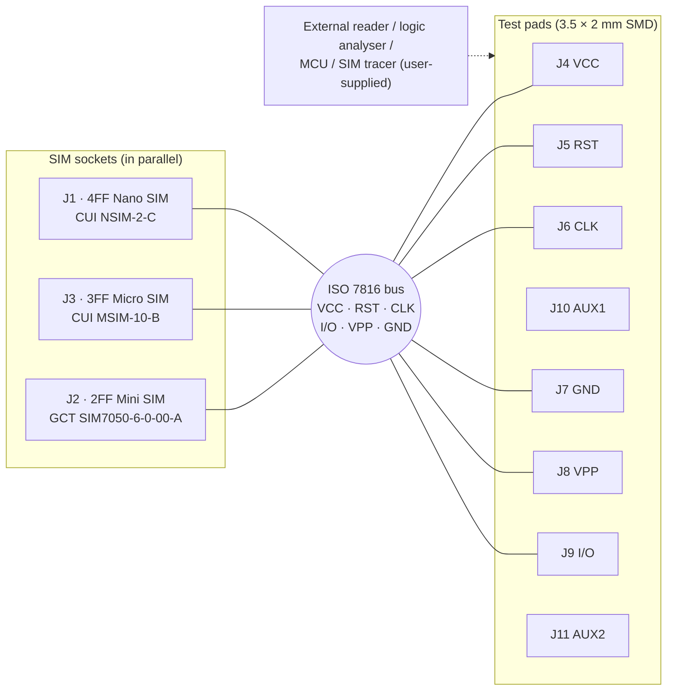
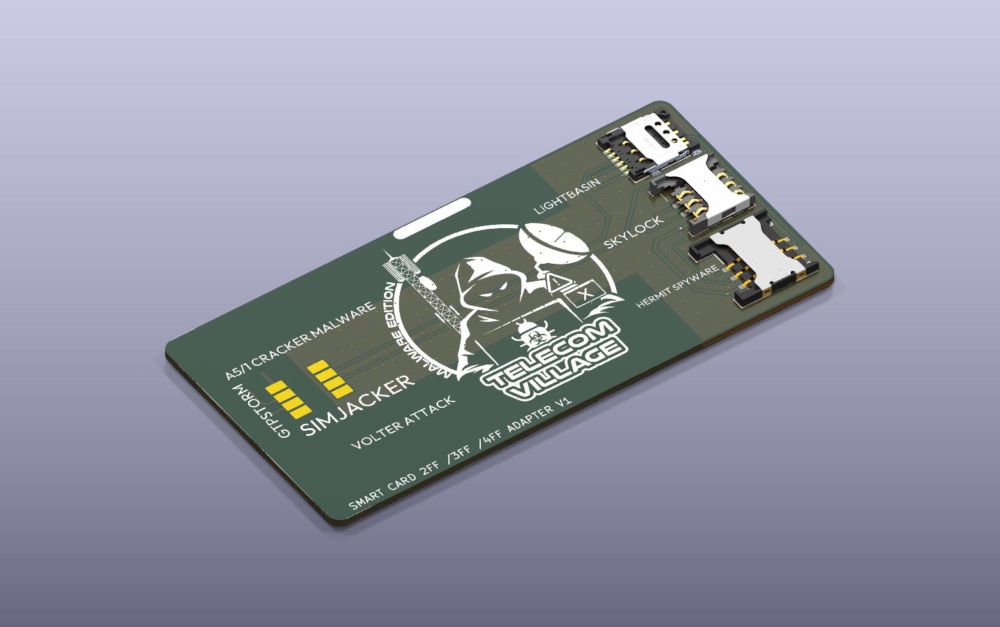
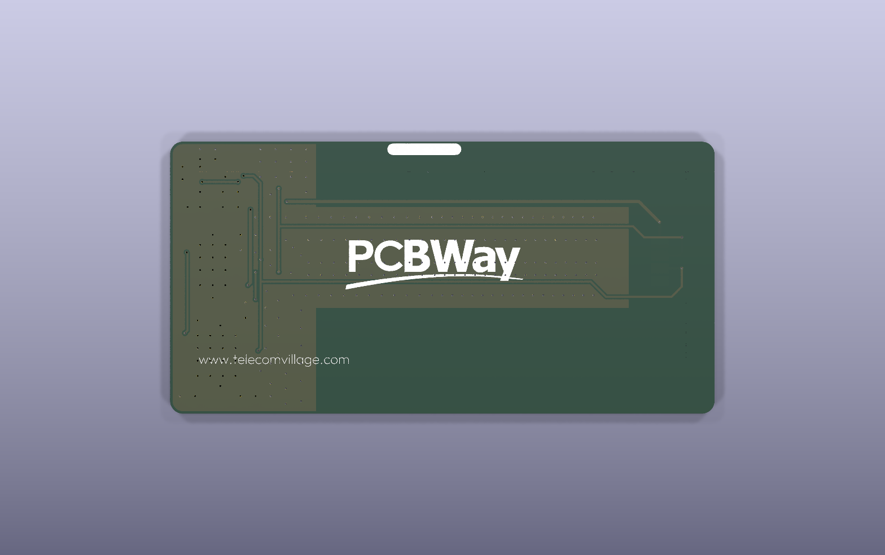
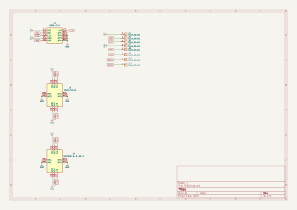

# Telecom Village Badge — Smart Card 2FF / 3FF / 4FF Adapter

> A credit-card-style conference badge PCB for **Telecom Village** (*"Malware Edition"*). It is also a working tool: three SIM-card sockets (Mini, Micro and Nano SIM) share one bus, and the ISO 7816 smart-card contacts are broken out to large test pads for probing.



| Front artwork | Back artwork |
|---|---|
|  |  |

---

## Overview

The board is a 2-layer, 1.6 mm FR-4 PCB. It is about **108 × 54 mm** with rounded corners, so it has the look of an event badge. The silkscreen on the copper side is **Telecom Village** artwork: a hooded hacker figure with a cell tower and a satellite dish, *"MALWARE EDITION"*, and the names of well-known telecom attacks and malware (SIMjacker, A5/1 cracker, GTPStorm, LightBasin, Skylock, Hermit spyware, VoLTEr attack). The silkscreen text names the board **"SMART CARD 2FF / 3FF / 4FF ADAPTER V1"**. The back carries a sponsor logo.

The design has no active parts. It has no MCU, regulator or firmware. Electrically it is a **passive SIM / UICC breakout**:

- **J2** is a 2FF (Mini SIM) socket, **J3** a 3FF (Micro SIM) socket and **J1** a 4FF (Nano SIM) socket. All three are wired in parallel to the same ISO 7816 nets.
- Eight **3.5 × 2 mm SMD test pads** (J4–J11) expose VCC, RST, CLK, I/O, VPP, GND and two spare AUX lines. You can connect them to a logic analyser, a smart-card reader, an SDR/SIM-tracing setup or a microcontroller.

*Inferred use:* hands-on SIM/UICC workshops at the village, such as sniffing APDUs, attaching a reader to a card of any size, or adapting one form factor to another. The design files don't state this. It follows from the topology and the event theme.

## Key features

- **Three SIM form factors on one badge:** 2FF / 3FF / 4FF sockets from CUI Devices and GCT.
- **All ISO 7816 contacts broken out:** C1 VCC, C2 RST, C3 CLK, C5 GND, C6 VPP and C7 I/O go to large SMD pads that are easy to clip or probe.
- **Two extra AUX pads** (AUX1/AUX2) for user wiring. They are not connected to the sockets.
- **GND pour on both layers** with about 240 stitching vias (0.6 mm / 0.3 mm drill).
- **Detailed silkscreen artwork** made from a custom ~430 kB KiCad footprint (`badge_fron`), plus a back-side sponsor logo.
- **Single-sided SMT assembly:** all 11 placed parts are on the top side.
- Gerbers, drill files, gerber job, pick-and-place and a STEP model are all included.

## Block diagram



## Bill of materials

Taken from the schematic and `Fabrication Files/PCB-top.pos`.

| Ref | Qty | Value / MPN | Manufacturer | Description | Footprint |
|---|---|---|---|---|---|
| J1 | 1 | NSIM-2-C | CUI Devices | Nano SIM (4FF) connector, 6 pos, hinged, SMT, 1.4 mm height | `Library:NSIM2C` |
| J2 | 1 | SIM7050-6-0-00-A | GCT | Mini SIM (2FF) connector, 6 pos, SMT | `Library:SIM70506000A` |
| J3 | 1 | MSIM-10-B | CUI Devices | Micro SIM (3FF) connector, 6 pos, push-in/pull-out, SMT, 1.8 mm height | `Library:MSIM10B` |
| J4–J11 | 8 | Conn_01x01 | — | Bare copper SMD test pad, 3.5 × 2 mm (no part to place) | `Library:PAD` |
| G\*\*\* | 2 | — | — | Silkscreen artwork: front badge art and back sponsor logo | `Library:badge_fron`, `Library:pcbway_logo` |

Datasheet links are stored in `Source Files/Library.kicad_sym`.

> Only **3 real components** need to be bought (J1–J3). J4–J11 are copper pads that appear in the CPL file. Remove them from the placement file before ordering assembly.

## Pin mapping (ISO 7816 contacts)

The board has no MCU. The table shows how each socket contact and test pad maps to a net.

| Net | Socket pad (J1 / J2 / J3) | Test pad | ISO 7816 function |
|---|---|---|---|
| VCC | C1 | J4 | Card supply |
| RST | C2 | J5 | Reset |
| CLK | C3 | J6 | Clock |
| GND | C5 + shield/mounting pads MP1–MP4 | J7 | Ground |
| VPP | C6 | J8 | Programming voltage / SWP (on modern UICCs) |
| I/O | C7 | J9 | Half-duplex serial data |
| AUX1 | — | J10 | Spare pad (net label only) |
| AUX2 | — | J11 | Spare pad (net label only) |

The pads sit in two columns of four on the left side of the badge. J4–J6 and J10 (x = 173.9 mm) form one column, and J7–J9 and J11 (x = 182.8 mm) form the other, at a 2.5 mm pitch.

## Power

The board has no on-board power. Whatever device is connected to the **VCC (J4) / GND (J7)** pads supplies the inserted SIM. ISO 7816 / 3GPP cards normally run at class C/B/A, which is 1.8 V, 3 V or 5 V. There is no regulation, protection or level shifting, so the user must match the card's voltage class. *(This is a general ISO 7816 note, not something stated in the design files.)*

> ⚠️ All three sockets share one bus. Insert **only one SIM at a time**.

## PCB specifications

| Parameter | Value |
|---|---|
| EDA tool | KiCad 8.0 (files generated with 8.0.6) |
| Layers | 2 (F.Cu / B.Cu) |
| Board outline | 107.95 × 53.975 mm, 2.54 mm corner radius (job file reports 108.05 × 54.075 mm including the outline stroke) |
| Thickness | 1.6 mm FR-4, 35 µm copper |
| Min. track / clearance | 0.4 mm track (from the job file); 0.2 mm pad/track clearance |
| Track widths used | 0.2 / 0.4 / 0.6 mm |
| Vias | 255 × 0.6 mm pad / 0.3 mm drill (mostly GND stitching) |
| Copper pours | GND zone on both layers |
| Plated holes / NPTH | Vias only. The NPTH file is empty, and the outline has no lanyard hole (see Notes) |
| Surface finish | Not specified (job file: `None`) |
| Silkscreen | Front: Telecom Village artwork, attack names, board title. Back: sponsor logo |

## Assembly

| Side | Placements in `.pos` | Real parts |
|---|---|---|
| Top | 11 (J1–J11) | 3 SIM sockets |
| Bottom | 0 | — |

- **Single-sided SMT.** The board needs no through-hole parts and only one reflow pass.
- `PCB-top.pos` / `PCB-bottom.pos` are KiCad CSV-style placement files in mm, using absolute board coordinates. For JLCPCB/PCBWay assembly, rename the columns to `Designator, Mid X, Mid Y, Layer, Rotation` and remove J4–J11. Check the socket rotations against the fab's preview.
- No BOM CSV is included. The table above contains everything needed to make one.

## Gallery

| Isometric | Top | Bottom |
|---|---|---|
|  |  |  |

**PCB layout:** 

**Schematic:** 

A PDF of the schematic is in [`docs/schematic.pdf`](docs/schematic.pdf).

## Repository structure

```
TelecomVillage-SIM-Adapter-Badge/
├── README.md
├── Badge Design_FRONT.png        # front artwork (source for silkscreen)
├── Badge Design_BACK.png         # back artwork
├── 3D File/
│   └── PCB.step                  # full-board 3D model
├── Fabrication Files/
│   ├── PCB-*.gbr                 # Cu, mask, paste, silk, edge cuts, drill maps
│   ├── PCB-PTH.drl / PCB-NPTH.drl
│   ├── PCB-job.gbrjob
│   ├── PCB-top.pos / PCB-bottom.pos
│   └── gerber.zip                # same gerbers + drills, zipped for upload
├── Source Files/
│   ├── PCB.kicad_pro / .kicad_sch / .kicad_pcb
│   ├── Library.kicad_sym         # custom symbols (3 SIM sockets)
│   ├── Library.pretty/           # custom footprints (sockets, PAD, artwork logos)
│   ├── 3D/                       # STEP models of the SIM sockets
│   └── fp-lib-table / sym-lib-table
└── docs/
    ├── schematic.pdf
    └── images/                   # 3D renders, layout & schematic SVGs
```

## How to open / manufacture

1. **Open:** install KiCad 8 or newer (KiCad 9 opens and upgrades the files). Open `Source Files/PCB.kicad_pro`. The project-local tables (`fp-lib-table`, `sym-lib-table`) load the custom `Library`, and the 3D models resolve through `${KIPRJMOD}/3D`.
2. **Order bare PCBs:** upload `Fabrication Files/gerber.zip` to JLCPCB, PCBWay or a similar fab. Use 2 layers, 1.6 mm thickness and a finish of your choice. For a badge, a black or white mask with the opposite silkscreen colour is recommended.
3. **Assembly (optional):** order J1–J3 using the BOM table, and use `PCB-top.pos` as the CPL (see Assembly). The sockets can also be hand-soldered with hot air or a fine-tip iron.
4. **Use:** insert one SIM, then connect your reader or analyser to the VCC/GND/CLK/RST/I/O pads.

## Notes

- The **lanyard slot** in the artwork is drawn on silkscreen only. The `Edge.Cuts` outline is a plain rounded rectangle, so attaching a lanyard would need a clip or an extra slot in a future revision.
- The drill files (`PCB-PTH.drl`) were generated on 2024-07-02, and the gerbers were regenerated on 2025-05-31 after artwork changes. Re-export the drills together with the gerbers before ordering.
- The 3D model linked to the MSIM-10-B footprint is `693010020611 (rev1).stp` (appears to be a Würth part number), and the one for NSIM-2-C is `G85D1160022HHR`. These look like stand-in models, so check the renders against the actual parts.

---

**Author:** [@zeyad-hisham-cyper](https://github.com/zeyad-hisham-cyper) — Embedded Systems & PCB Design · Part of the [Freelance Projects](../README.md) portfolio

*"Telecom Village" artwork and the sponsor logo belong to their respective owners and are shown here as portfolio context only.*
